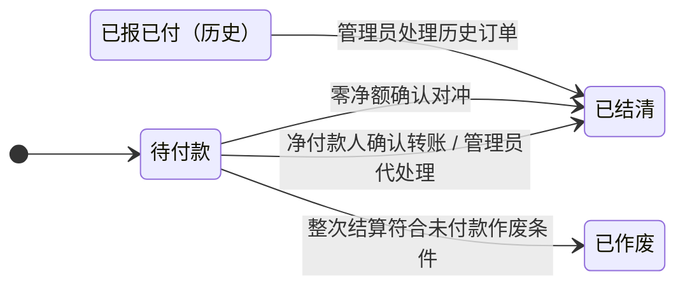

# 结算中心

紧凑账本，沿用 Sub2API 青绿色及深浅主题，借鉴 Linear 的层级和细分隔线，不使用其品牌素材。

- 浅色：画布 #f6f8f8、表面 #ffffff、正文 #21312f、次要 #778782、边线 #e4eae7、强调 #0e9d8d。
- 深色：画布 #111c1a、表面 #192622、正文 #e5eeeb、次要 #95aaa2、边线 #30413b、强调 #45cdb1。
- 系统中文字体；字号 11 / 12 / 13 / 14 / 16 / 21 / 34。金额等宽数字右对齐，货币金额统一两位小数。
- 账号成本是表格，待付款按对方用户汇总，突出净应付；收款只读展示付款人、订单数、净应收和状态。对冲历史按一次付款展示，明细保留双向原单。预计待付、已出单待付分开；不添加重复副标题、无用说明或装饰卡片。
- 移动端 760px 以下使用单列账号块、全屏表单；表单标签在输入框上方。长账号名称换行，页面不横滚。
- 免费、待配置、进行中、待付款、待管理员处理、已结清、差异状态文字明确；颜色不是唯一信号。
- 成本编辑保留草稿，服务端拒绝陈旧版本；弹窗未提交不覆盖表单输入。关闭和 Escape 不提交。
- SSO 跟随主站 theme 参数，界面不显示 Token、连接配置或内部字段。
- 真实 iframe 入口、深浅主题、窄屏、键盘焦点、空状态和错误都需验收。

## 订单状态

新订单确认转账后直接结清，不再进入“已报已付”。对冲是结清方式，原始订单仍为“已结清”；收款方无确认或退回操作。历史待处理订单不参与实时净额计算。已结清订单不可作废。
