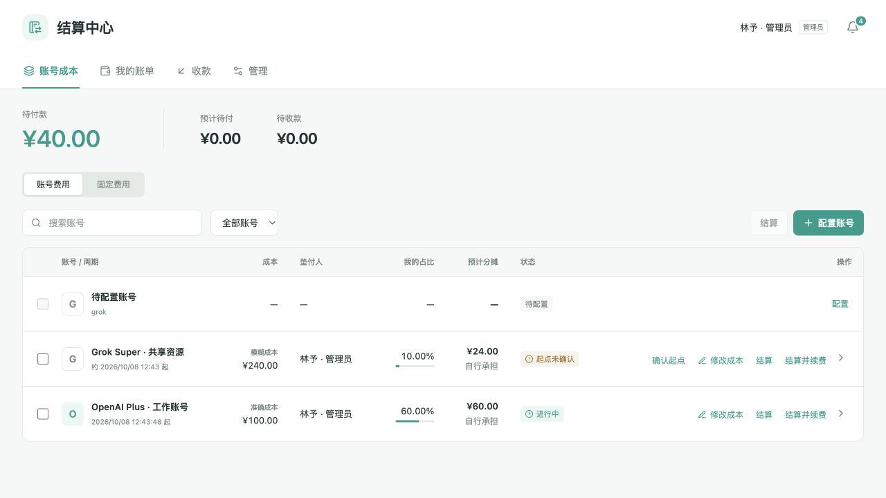

# Sub2API 结算中心

[English](README.md)

用于分摊 Sub2API 账号成本、固定费用和记录线下付款的独立账本。Rust 后端与 React 前端部署在 `/settlement/`，通过主站同域菜单登录。

支持准确成本分摊、供应商整组统一成本、上游账单精准匹配、手动结算与续费及双方账单自动对冲。人民币金额以整数分保存，结算后冻结账目；无需接入支付渠道，不扣减 Sub2API 余额。



## 快速开始

仓库已固定 Rust 1.99.0、Node 24.21.0 和 pnpm 12.11.2。使用临时演示账本体验：

```sh
pnpm --dir frontend install --frozen-lockfile
pnpm --dir frontend build
cargo run --locked -p settlement-tools -- demo --netting-fixtures
```

打开命令输出的本机地址。演示提供三位虚构用户和测试用量，不连接生产数据库；按 Ctrl+C 退出。演示与负载工具不进入运行镜像。

正式部署请复制 `.env.example` 为 `.env`，配置专用只读数据库角色、持久目录及主站同域 Nginx 路由。完成[部署指南](docs/deploy.md)后运行 `docker compose up -d --build`。

环境变量、默认值和测试专用配置均见部署指南。凭据和账本文件不要提交到 Git。

- [结算规则](docs/rules.md) · [部署与 Sub2API 字段兼容](docs/deploy.md)
- [升级与回滚](docs/upgrade.md) · [参与开发](CONTRIBUTING.md)
- [更新日志](CHANGELOG.md) · [发布流程](RELEASING.zh-CN.md) · [MIT 许可](LICENSE)
